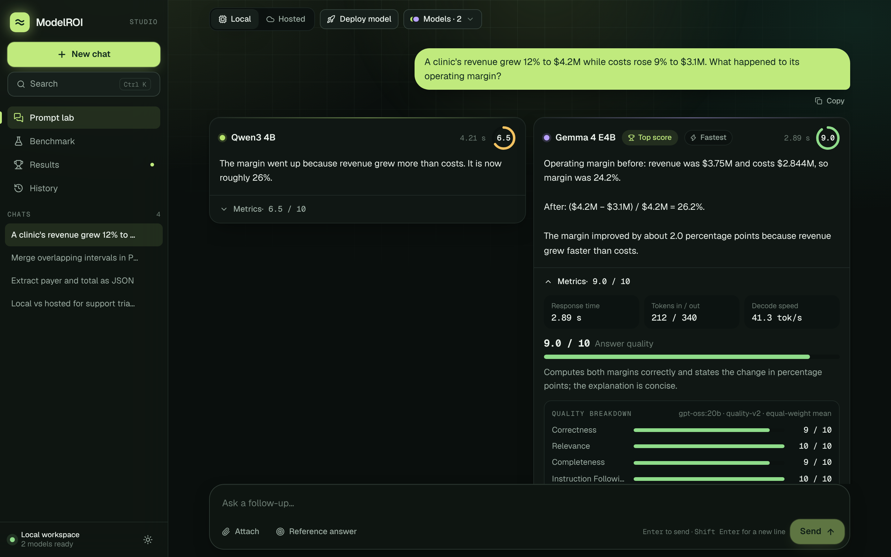
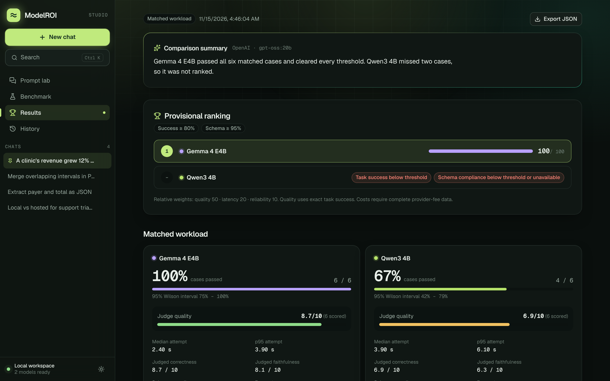
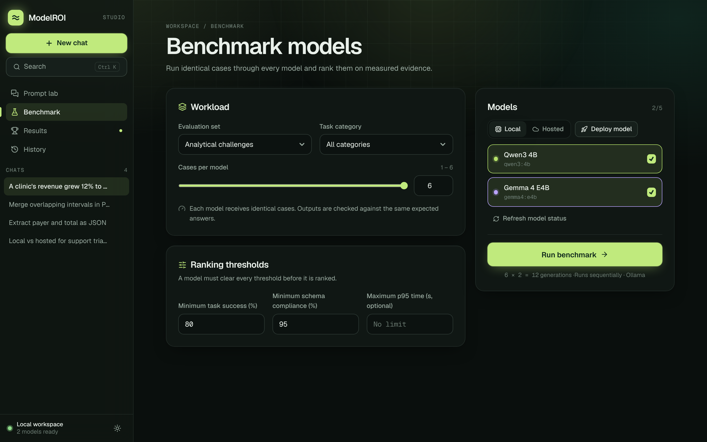
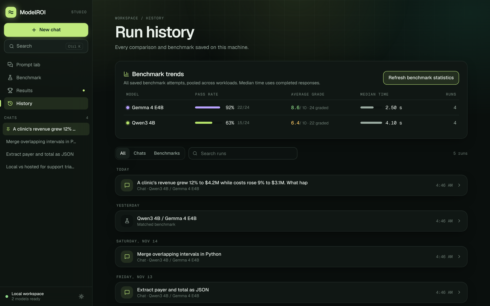
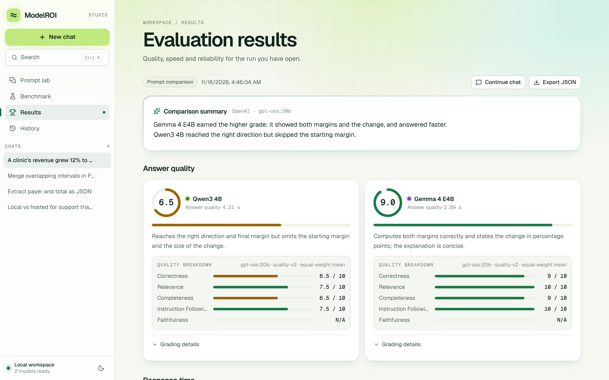

# ModelROI AI

Compare language models on the same question or the same benchmark, and see answer quality next to
speed, reliability and cost. Runs on free local models through [Ollama](https://ollama.com), with an
optional hosted mode for API models. An independent judge model grades every answer.



Screenshots in this README are generated from sample data by `web/capture_screens.py`. They show the
interface, not measured model results.

## What it does

- **Prompt lab.** Ask once and every selected model answers the same prompt. Answers arrive as each
  model finishes. Follow-up questions keep each model's own bounded conversation context. Attach a
  document (PDF, Word, Excel, PowerPoint, CSV, text) to compare models on an excerpt.
- **Independent grading.** A separate judge model scores each answer out of 10 on correctness,
  relevance, completeness, instruction following and faithfulness, with a one-sentence reason. Add a
  **Reference answer** and only the judge sees it.
- **Matched benchmarks.** Run up to five models on identical cases: six analytical challenges in
  math, coding and operations, or 50 draft graded cases. Executable checks compare exact expected
  values and JSON structure, separately from the judge's qualitative grade.
- **Threshold-first ranking.** A model must clear minimum task success, schema compliance and an
  optional p95 latency limit before it is ranked. Eligible models get a weighted score from task
  success, speed, provider fees and request reliability.
- **Results you can audit.** Case-level evidence, 95% Wilson intervals, paired comparisons with
  Holm-adjusted p-values, token counts and timings, plus JSON export.
- **History and trends.** Every run is saved locally in SQLite. DuckDB pools pass rates, mean grades
  and median latency across saved benchmarks.
- **Your own models.** Deploy a local Ollama responder with its own system instructions, or import
  your own weights, and test it beside the built-in candidates.

## Interfaces

- **Web studio** ([`web/`](web/README.md)): Svelte 5, TypeScript, Tailwind CSS v4 and Vite. A
  dark-mode-first workspace with a full light theme, a `⌘K` command palette, live run progress and
  a phone layout. FastAPI serves the built bundle, so no Node.js is needed to run it.
- **REST API** (FastAPI): models, prompt comparison, benchmarks, history and analytics under
  `/studio`, with progress streamed as newline-delimited JSON.
- **Launchers** (`scripts/`): `start_local.py` checks Ollama, creates a virtual environment and
  opens the studio; `start_pilot.py` shares an invite-only tester session.
- **Streamlit preview** (`src/modelroi/ui`): the original offline dashboard, which runs without
  Ollama on mock data.

## Why it is built this way

A model comparison is only useful if you can see how each number was produced. The design keeps
measured facts, judged opinions and estimates apart:

| Concern | Approach |
|---|---|
| Fair comparison | Every model receives identical prompts and cases, run sequentially to limit memory pressure |
| Correctness | Deterministic checks for exact values and JSON types (numeric `1` does not equal `true`) |
| Answer quality | A separate judge model grades each answer with a published rubric; its identity and rubric version are stored with the grade |
| Small samples | 95% Wilson intervals on success rates; paired exact tests with Holm adjustment between models |
| Honest failures | Exceptions count as failed cases, truncated outputs fail grading, and no winner is claimed on draft cases |
| Privacy and cost | Local mode uses only Ollama on your machine; hosted mode states exactly what is sent to which provider |
| Reproducibility | Each run records model digest, dataset SHA-256, settings, token counts and UTC start time |

See [docs/architecture.md](docs/architecture.md) for the design and
[docs/methodology.md](docs/methodology.md) for how grades, metrics and rankings are calculated.

## Model choices

| Role | Local mode (Ollama) | Hosted mode |
|---|---|---|
| Responders | `qwen3:4b`, `gemma4:e4b`, plus any model you deploy or import | Gemini Flash-Lite, Qwen 3.8 27B, Gemma 4 26B, Mistral Small, Llama 3.3 70B |
| Judge and summaries | `gpt-oss:20b` | GPT-OSS 120B served by Groq |
| Models per run | Up to 5 | Up to 5 |

Each run uses one mode. Hosted models need provider keys; see
[hosted setup and credentials](docs/setup.md#hosted-api-mode). Background on the choices is in
[docs/api_selection.md](docs/api_selection.md).

## Quickstart

Requires Git, Python 3.12 or newer and [Ollama](https://ollama.com/download). Open Ollama first.

```bash
git clone https://github.com/SheikhRobinEmon-USF/Model-ROI-AI.git
```

```bash
cd Model-ROI-AI
```

```bash
ollama pull qwen3:4b && ollama pull gemma4:e4b && ollama pull gpt-oss:20b
```

```bash
python3 scripts/start_local.py
```

On Windows, use `py -3.12 scripts/start_local.py` for the last command. The launcher creates a
virtual environment, installs dependencies and opens the studio at the printed local URL. To update
a clone, stop the launcher, run `git pull --ff-only` and start it again.

Platform notes, hosted keys, importing your own weights, storage migration and the tester pilot are
in [docs/setup.md](docs/setup.md).

### Offline preview with Docker

```bash
docker compose up
```

This starts the mock API on http://localhost:8000 and the Streamlit preview on
http://localhost:8501. Local model inference is not wired into the containers; use the launcher
above for real runs.

## Screens

| Benchmark results | Benchmark setup |
|---|---|
|  |  |
| **History and trends** | **Light mode** |
|  |  |

## Evidence and limits

The studio is a development preview.

| | |
|---|---|
| Benchmark cases | 50 draft synthetic cases in [`datasets/v1`](datasets/v1/draft_cases.jsonl), plus 6 analytical challenges |
| Holdout | None evaluated yet ([holdout gate](evals/holdout/README.md)) |
| Saved runs | SQLite under `~/.modelroi/runs`, including submitted excerpts |
| Hosting | Local only; public hosting is deferred |

Important limitations: hospital cases are synthetic arithmetic examples, not verified CMS facts;
latency is specific to your machine and exploratory with fewer than 100 observations; zero provider
fees do not mean zero electricity or hardware cost; and judge grades are assessments, not measured
hallucination rates. No comparative model winner is claimed. See
[docs/methodology.md](docs/methodology.md#limits).

Remaining release gates:

- Actual Qwen3 run and reviewed output evidence on target hardware.
- Independently reviewed, diverse labels and an untouched holdout.
- Full financial, citation and refusal graders and a recommendation policy.
- Cancellation, report sanitization and validated import of external historical runs.
- Reproducible dependency locking, container verification, cross-platform CI and public deployment checks.

## Project structure

```
web/           Svelte 5 studio (see web/README.md)
src/modelroi/
  api/         FastAPI service and the /studio routes
  providers/   Ollama client, hosted provider routes, user-deployed models
  graders/     exact-match checks and judge-model quality grading
  execution/   benchmark runner, run-scoped progress events, budget ledger
  datasets/    case validation, analytical challenges, document excerpts
  storage/     SQLite run history and DuckDB benchmark analytics
  ui/          Streamlit preview and shared comparison logic
datasets/      draft benchmark cases
evals/         holdout gate
scripts/       local launcher and tester pilot
tests/         unit and integration tests (no network, no models)
docs/          architecture, methodology, setup, decisions, screenshots
```

## Development

```bash
make install
```

```bash
make test
```

```bash
make web
```

`make web` rebuilds the studio bundle in `web/dist`, which is committed so the launcher works
without Node.js. `make check-web` runs the browser checks at desktop and phone widths, and
`make screenshots` regenerates the images in `docs/images`; both need `make api-local` running in
another terminal.

CI runs the Python tests, rebuilds the studio bundle and fails if it differs from the committed
one, then runs the browser checks.

## Disclaimer

An independent portfolio project. Not affiliated with or endorsed by any model provider. Results
on draft cases are exploratory and are not a recommendation to adopt or reject a model.

## License

Original application code is MIT licensed; see [LICENSE](LICENSE). Model weights are not bundled
with this repository. Qwen3 4B model artifacts keep their
[Apache 2.0 license](https://huggingface.co/Qwen/Qwen3-4B/blob/main/LICENSE) and are downloaded
separately.
