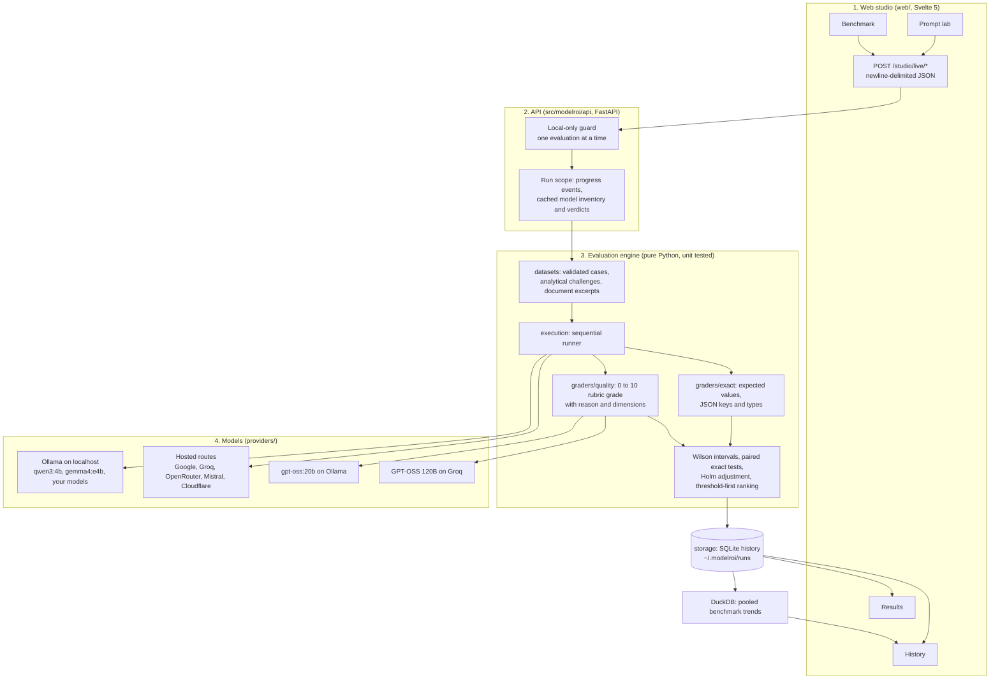

# Architecture

ModelROI has four layers. Models only ever produce text: every count, rate, interval and ranking is
computed by deterministic Python, and the judge's opinion is stored separately from the measured
checks.

## Design decisions

**One bundle, one process.** FastAPI serves the built studio from `web/dist` and the `/studio` API
from the same origin. The launcher needs Python and Ollama only; Node.js is a development
dependency. The bundle is committed, and CI fails if a rebuild differs from it.

**Local by default, and guarded.** The `/studio` routes answer only when the launcher sets
`MODELROI_ENABLE_LOCAL=true` and the request comes from `localhost` or `127.0.0.1`. POST requests
must carry a matching `Origin`, so another site open in the browser cannot start a run.

**One evaluation at a time.** A process-wide lock rejects a second run with HTTP 409. Ollama runs
candidates sequentially, which keeps memory pressure predictable on a laptop and makes latency
figures comparable between models in the same run.

**Progress comes from the server.** A run streams `status`, `answer`, `complete` and `error` events
as newline-delimited JSON. The studio shows the stage the server reports (prepare, generate, grade,
save) and never estimates completion.

**Measured checks and judged quality stay separate.** `graders/exact.py` decides pass or miss from
expected values and JSON structure. `graders/quality.py` asks a judge model for a 0 to 10 grade with
a reason and per-dimension scores. Rankings use the measured task success; the judge's grade is
shown beside it, never mixed into it.

**The judge is a different model from the candidates.** Local mode grades with `gpt-oss:20b`;
hosted mode grades with GPT-OSS 120B on Groq. The judge's identity and rubric version are saved with
every grade, and older holistic grades keep their original meaning.

**Each model keeps its own conversation.** A follow-up sends each candidate a bounded slice of its
own earlier answers (`chat_context.py`), so one model never sees another's output.

**History is transactional.** Runs are written to SQLite in a single transaction, with an indexed
summary row so lists load without reading full answers. DuckDB is opened only for the pooled trends
query and closed afterwards.

**Hosted routes are fixed.** `providers/hosted.py` maps each hosted responder to one provider and
one environment variable. There is no fallback to a different or paid model, and keys stay on the
server.

## Request flow for a prompt comparison

1. The studio posts the prompt, selected models, optional reference answer and the previous turn's
   ID to `/studio/live/prompt`.
2. The API loads the earlier turns of that chat, within the context budget.
3. Each model generates in turn. Its answer is streamed to the browser as soon as it finishes.
4. The judge grades each delivered answer. Truncated answers are flagged to the judge.
5. The run is saved, and the final report replaces the partial one in the browser.
6. Opening **Results** requests a short comparison summary from the judge, which is cached with the
   run.

## Where things live

| Path | Responsibility |
|---|---|
| `web/src/lib/studio.svelte.ts` | All studio state and API calls |
| `web/src/components/` | Views: prompt lab, benchmark, results, history, command palette |
| `src/modelroi/api/studio.py` | `/studio` routes, streaming, benchmark orchestration |
| `src/modelroi/providers/` | Ollama client, hosted routes, user-deployed models |
| `src/modelroi/graders/` | Exact checks and judge grading |
| `src/modelroi/execution/` | Benchmark runner, run scope, budget ledger (not yet wired to a provider runner) |
| `src/modelroi/evaluation_policy.py` | Thresholds and weighted ranking |
| `src/modelroi/storage/history.py` | SQLite history and DuckDB analytics |

Earlier decisions and their sources are recorded in [decision_log.md](decision_log.md). The original
plan and historical baseline are in [implementation_contract.md](implementation_contract.md).
