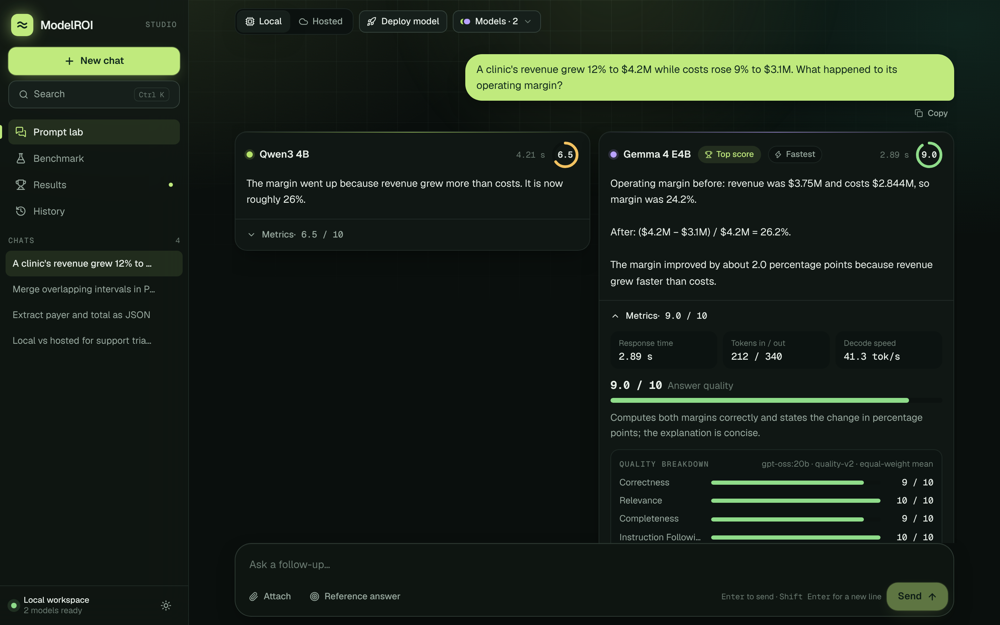

# ModelROI: web studio

The primary interface for ModelROI: a Svelte 5 workspace for comparing model answers, running
matched benchmarks and auditing the results. It talks to the FastAPI service in the repository
root; every figure on screen comes from that API.



## Stack

| Concern | Choice |
|---|---|
| Framework | Svelte 5 (runes) built with Vite |
| Language | TypeScript |
| Styling | Tailwind CSS v4 with design tokens; dark-mode-first with a full light theme |
| Icons | lucide |
| Motion | Svelte transitions and CSS animation, disabled under `prefers-reduced-motion` |
| Charts | Hand-written SVG and CSS: score rings, rubric bars, latency bars, leaderboards |
| Fonts | Geist and Geist Mono, self-hosted variable fonts |
| Command palette | Built in (`⌘K` / `Ctrl K`): jump between views, open any chat, switch mode or theme |

## UX

- **One prompt, every model.** Answers appear side by side as each model finishes, with placeholder
  cards for models still generating or queued.
- **Evidence beside the answer.** Each answer carries a score ring and response time; expand
  **Metrics** for tokens, decode speed, the judge's reason and a per-dimension breakdown.
- **Honest progress.** The stage bar (prepare, generate, grade, save) follows events from the
  server and never estimates completion.
- **A colour per model.** Each model keeps the same hue across answers, leaderboards and charts.
- **Chats that stay organised.** Pin, rename, filter and delete conversations from the sidebar.
- **Works on a phone.** Bottom tab bar, slide-in chat drawer, and no horizontal scrolling down to
  320 px.
- **Accessible.** Keyboard reachable throughout, labeled controls, visible focus rings, native
  `<dialog>`, `<meter>` and `<progress>` semantics.

## Bundle

Production build (`npm run build`):

| Asset | Size | Gzipped |
|---|---|---|
| JavaScript | 163 kB | 54 kB |
| CSS | 48 kB | 10 kB |
| Fonts (2 variable files) | 53 kB | already compressed |

The whole studio is one static bundle with no runtime requests to third parties, so it works
offline once the page has loaded.

## Run

The studio is served by the API, so the normal way to use it is the launcher in the repository
root:

```bash
python3 scripts/start_local.py
```

To work on the studio itself, rebuild the bundle after each change and reload the page:

```bash
npm ci
```

```bash
npm run build
```

Commit the rebuilt `dist/` with your change. CI rebuilds the bundle and fails if it differs from
the committed one.

## Checks

Both scripts need the API running on port 8598 (`make api-local` from the repository root) and
Python Playwright (`pip install playwright && python -m playwright install chromium`).

```bash
python web/check_browser.py
```

Drives the studio at 1280, 390 and 320 px against a mocked API: sends prompts and follow-ups, opens
metrics, switches to hosted mode with five models, reopens a saved chat, and asserts there is no
horizontal overflow.

```bash
python web/capture_screens.py
```

Regenerates the README screenshots in `docs/images` from sample data.

## Structure

```
src/
  main.ts                 entry point
  App.svelte              shell: sidebar, mobile bars, page switch
  app.css                 design tokens, base styles and component classes
  lib/
    studio.svelte.ts      all state, derived values and API calls
    format.ts             number, time and date formatting
    motion.ts             transition presets that respect reduced motion
  components/
    PromptLab.svelte      chat feed, answer cards, model picker, composer
    Benchmark.svelte      workload, thresholds and model selection
    Results.svelte        summary, ranking, metrics and case inspector
    History.svelte        trends table and searchable run list
    ChatList.svelte       sidebar conversations with rename, pin and delete
    CommandPalette.svelte keyboard command menu
    DeployDialog.svelte   deploy a local Ollama responder
    RunProgress.svelte    live stage indicator
    ScoreRing.svelte, Rubric.svelte, SplitRating.svelte, ModeSwitch.svelte, RoutingNote.svelte
check_browser.py          responsive behaviour checks
capture_screens.py        README screenshot generator
```
